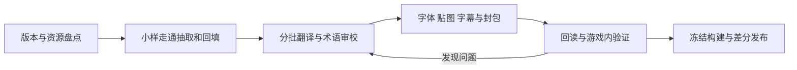

# Game Localization Skill · 游戏汉化工程

一套给 AI 编程助手和汉化团队使用的可复用工作流程，支持 **日文→中文、英文→中文** 及日英混合资源：从版本确认、资源盘点、翻译审校，到字库、贴图、字幕、封包、运行验证和补丁交付。

**这是工程方法与检查工具，不是“一键支持所有游戏”的汉化器。** 流程基于多个主机/PC 汉化项目经验梳理，并参考传统 ROM 汉化和现代本地化工具的一手资料。

[阅读 Skill](skills/game-localization/SKILL.md) · [工作流与适配器约定](skills/game-localization/references/workflow.md) · [工具包与清单手册](skills/game-localization/references/toolkit.md) · [多端兼容说明](docs/COMPATIBILITY.md) · [下载发行包](https://github.com/AmuroRX-93/game-localization-skill/releases/latest)

## 它解决什么

- 把所有已发现资源和未知区域列清楚，防止“正文翻完了”掩盖按钮贴图、更新资源和过场漏译。
- 日文或英文原文／中文按稳定 ID 对照，术语有来源，校对意见可回写。
- 将译义、字码、字形和排版问题分开处理，避免修译文却修错层。
- 保护指针、控制码、资源键、图集边界和运行时内存预算，UI 贴图采用底图重建加独立排字。
- 将文件通过、写入通过、实际运行通过、发布成功分别记录。
- 为原版安装、旧汉化升级和回退提供清楚的交付要求。



## 本次重构（v0.7.0）

- **架构瘦身与去重**：将原有 19 份碎片化文档（1,035 行）重构合并为 **1 份主入口 + 10 份职责正交的专项参考（578 行）**，消除多处重复描述并修复全部内部锚点链接。
- **剥离个人私有规则**：移除带日期的个人硬性偏好（私人仓库同步授权、旧镜像自动清理授权、默认静音测试、特定项目历史记录），恢复公开通用 Skill 的清晰边界。
- **扩展多客户端支持**：在原有 Codex、Cursor、Kimi Code、Qwen Code、CodeBuddy 基础上，新增 **DeepSeek Harness (DSH)** 与 **Antigravity** 适配说明与打包支持（[COMPATIBILITY.md](docs/COMPATIBILITY.md)），非 Codex 包自动排除 `agents/openai.yaml` 与 `build_mission_review.mjs`。
- **工具分层清晰化**：在 [toolkit.md](skills/game-localization/references/toolkit.md) 中明确区分跨游戏通用命令与单一游戏示例适配器边界。

## 安装和使用

执行 `python3 tools/build_packages.py` 可从同一份源码生成各客户端安装包与总包，或直接复制 `skills/game-localization/` 到对应工具的技能目录：

- **Codex**：`~/.codex/skills/game-localization/`（[CODEX.md](docs/CODEX.md)）
- **Antigravity**：`~/.gemini/config/skills/game-localization/` 或项目 `.agents/skills/game-localization/`（[ANTIGRAVITY.md](docs/ANTIGRAVITY.md)）
- **DeepSeek Harness (DSH)**：`~/.dsh/skills/game-localization/` 或工作区 `.dsh/skills/game-localization/`（[DSH.md](docs/DSH.md)）
- **Cursor**：`~/.cursor/skills/game-localization/` 或项目 `.cursor/skills/game-localization/`（[CURSOR.md](docs/CURSOR.md)）
- **Kimi Code / Qwen Code / CodeBuddy**：详见 [兼容范围](docs/COMPATIBILITY.md)

## 离线工具与测试

核心脚本仅依赖 Python 3.9+ 标准库；贴图与字体功能按需安装 `skills/game-localization/scripts/requirements-ui.txt`：

```sh
python3 skills/game-localization/scripts/localization_toolkit.py doctor
python3 skills/game-localization/scripts/toolkit_selftest.py
python3 skills/game-localization/scripts/audit_ledger.py skills/game-localization/references/demo-ledger.json
python3 -m unittest discover -s tests -v
```

详细命令、支持边界与项目清单 schema 见 [toolkit.md](skills/game-localization/references/toolkit.md)；可选影音转写与字幕预览工具见 [media-and-subtitles.md](skills/game-localization/references/media-and-subtitles.md)。

## 仓库结构

- `skills/game-localization/`：可直接安装的 Skill 主文档、10 份专项参考、数据模板与离线脚本。
- `docs/`：Codex、Antigravity、DSH、Cursor、Kimi Code、Qwen Code、CodeBuddy 安装与兼容说明。
- `tools/build_packages.py`：从单一源码构建 7 种客户端包与 1 个总包。
- `tests/`：全部脚本的合成数据单元测试，无需任何游戏文件。
- `VALIDATION.md`：历史验证范围与场景审查记录。

## 许可

本仓库原创文档与代码采用 MIT 许可；第三方资料、字体与游戏资产不受此许可覆盖，本仓库不携带私人聊天、游戏二进制、译文全集、商业字体、BIOS 或存档。
